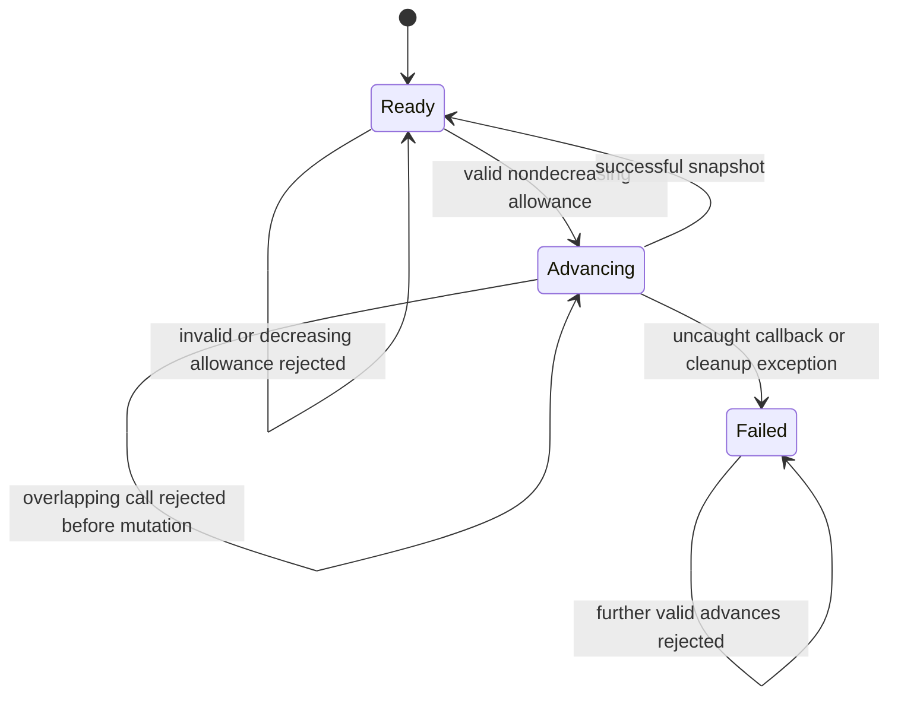

# Budget controller transitions and audit

This document describes the Python execution contracts of `RMSLadder`,
`ConfidenceLadder`, `LawPilot`, `TailMassProbe`, and
`FiniteFamilyConfidenceLadder`, including the shared capped generator executor.
The audit started from commit `3177cfe4996259d18c4a83ca68a17c9b3ca71eb7` on
6 November 2026. It changes only unfrozen toolkit implementation, tests, and
documentation. It does not change statistical assumptions, Lean specifications,
frozen sources, or published verification records. Python execution and its
PRNG remain outside the Lean proofs.

## Common lifecycle

`advance_to(B)` authorizes a **cumulative** nonnegative integer allowance.
Authorization, reserved stage caps, and actual attempted observations are
different quantities. Successful snapshots satisfy `flips <= B`; ladder
snapshots additionally satisfy `flips <= reserved_budget <= B`.



The overlap arrow describes the rejected caller: the active invocation retains
ownership. If a callback catches that `RuntimeError`, the active invocation can
continue. If it lets the error escape, normal failure invalidation applies.
Each instance has its own nonblocking lock, so a parent controller can advance
its distinct child controller. Concurrent calls on the same instance are
rejected rather than queued. This guard does not make arbitrary external
mutation of controller fields or shared callbacks safe.

Repeated allowances perform no additional work after a successful call.
Invalid input and decreasing allowances are rejected before changing the
authorization or consuming randomness/observations. These input errors are
recoverable. A callback failure, including `KeyboardInterrupt` or `SystemExit`,
is not recoverable: an observation may already have been consumed without a
usable returned bit. The original exception propagates and the controller is
invalidated.

No successful snapshot is returned for a failed call. A previously returned
snapshot describes its own completed call, not any partially consumed work
from the failed call. Stage ledgers are committed after successful execution
and cleanup; they are not a recovery log for failed stages. The controllers
do not roll back external observations or retry failed callbacks.

## Capped generator executor

Implementation: [`_execute`](../toolkit/threshold_toolkit/budget_ladders.py).
The median amplifier's [`_run_block`](../toolkit/threshold_toolkit/confidence_amplification.py)
uses the same request/response protocol with its own timeout fallback.

| State/event | Action | Next state |
|---|---|---|
| Unstarted generator | Call `next()` | Await a query, or finish immediately with zero flips |
| Valid query and remaining cap | Create its coin once if needed; charge an attempted flip before calling its source | Await returned bit |
| Valid returned bit | Send it to the generator | Await next query, or finish |
| Generator returns after the final allowed bit | Accept the output | Completed, **not** timed out |
| Generator requests another flip at the cap | Do not create a coin or purchase another observation | Timed out |
| Invalid query/bit, source error, or program error | Propagate the error | Failed |
| Completed, timed out, or failed | Close the generator in `finally` | Closed; cleanup errors propagate |

Coin IDs identify persistent sources within one execution. Each independent
stage or median block gets a fresh namespace. A timed-out generator is closed,
not saved for resumption. The executor checks query validity before checking
the cap: an invalid query at the boundary is a protocol failure, not a timeout.
The median executor returns `rho/2` on timeout; `_execute` returns a timeout flag
and no estimate. Trusted callbacks must obtain observations through this
protocol. The cap does not constrain CPU time, arbitrary callback side effects,
or extra sampling hidden inside a callback.

## RMS and confidence ladders

Implementations: [`RMSLadder`](../toolkit/threshold_toolkit/budget_ladders.py)
and [`ConfidenceLadder`](../toolkit/threshold_toolkit/confidence_ladders.py).

Stage `j` reserves `4 * 2**j` flips. Stages become eligible at cumulative
allowances `4, 12, 28, 60, ...`. They run only when the whole next cap fits the
reservation schedule. Early completion does not release its unused reservation
for an extra stage. Allowances between checkpoints perform no partial stage.

| Event | RMS state | Confidence state | Accounting |
|---|---|---|---|
| Before the first stage | Estimate `upper/2` | Interval `[0, upper]` | Zero spend and reservations |
| Stage completes | Replace estimate with clipped output | Intersect with the returned `ClosedInterval` | Record actual flips and reserve the full cap |
| Stage times out | Retain previous estimate | Retain previous interval | Record timeout and reserve the full cap |
| Interval intersection becomes empty | Not applicable | Remains empty under future intersections | Later eligible stages still run |
| Callback, output validation, or cleanup fails | Invalidate | Invalidate | No successful stage snapshot; never resume |

Each completed or timed-out confidence stage spends its scheduled failure
allowance `delta / ((j+1)*(j+2))` exactly once, even if it used zero observations.
Timeout does not reclaim that allowance. Result history records both completed
and timed-out stages, so repeated calls do not rerun either kind.

## Resumable pilots

| Controller and state | Trigger | Transition |
|---|---|---|
| [`LawPilot`](../toolkit/threshold_toolkit/law_identification.py): no active coin | Authorized work remains | Create one source and start a prefix |
| Law pilot: partial prefix | Another paid bit | Update parity; record each even-prefix moment |
| Law pilot: partial prefix | Allowance reached | Pause with the same source, prefix, parity, and accumulated moments |
| Law pilot: coin prefix complete | `2 * moments` bits read | Start the next independent coin if allowed |
| Law pilot: full planned cap reached | All planned samples acquired | Select a candidate once; result becomes terminal |
| Law pilot: singleton family | Construction | Completed immediately with zero observations |
| [`TailMassProbe`](../toolkit/threshold_toolkit/tail_mass.py): partial prefix | Allowance reached | Pause with the same coin, heads, prefix length, and checkpoint level |
| Tail probe: checkpoint reached | Strict classification boundary crossed | Count a completed coin, reset its prefix, and continue with a fresh coin |
| Tail probe: intermediate checkpoint | Boundary not crossed | Advance to the next checkpoint |
| Tail probe: final checkpoint | Boundary not crossed, including equality | Count the coin and enter terminal `unresolved` state |
| Either terminal pilot | More authorization | Update authorized allowance without further sampling |
| Either pilot | Callback failure or interruption | Invalidate permanently |

The tail probe's `unresolved` state is a successful terminal outcome. It differs
from an allowance pause and from invalidation. A completed law pilot retains
its original result, including the observation count at completion.

## Finite-family handoff

Implementation: [`FiniteFamilyConfidenceLadder`](../toolkit/threshold_toolkit/finite_family_confidence.py).
Let `H` be the fixed identification cap.

| State | Trigger | Transition and budget |
|---|---|---|
| Identifying | `B < H` | Advance pilot to `B`; report `[0, rho]` |
| Identifying | Pilot reaches `H` | Select law and construct the continuation exactly once |
| Continuing | Authorized total `B >= H` | Advance child confidence ladder to `B - H` |
| Either phase | Uncaught child/callback failure | Invalidate the parent; prohibit retries |

Identification spends half of the failure allowance; the continuation uses
the other half. Its coins and private seed are separate from the pilot's.
The outer guard remains held through the handoff and the child call. The
combined flip count includes pilot and continuation observations; combined
reservations include the completed pilot cap plus child reservations.
Singleton families start with `H = 0` and enter the continuation immediately.

## Findings and regression coverage

1. **Re-entry could overspend or corrupt accounting.** Before the fix, an RMS
   program factory could call its own ladder's `advance_to(4)` once, then return
   a four-flip program. The nested call bought four flips, the outer call bought
   four more, and only then did the reservation assertion fail. All five
   persistent controllers now reject overlapping advances before any ledger
   mutation. The guard covers program factories, source factories, source
   flips, generator execution and finalizers, and calls from another thread.
2. **Tail probes could resume after interruption.** The tail probe caught
   `Exception`, while the other controllers caught `BaseException`.
   `KeyboardInterrupt` or `SystemExit` could escape after an attempted flip and
   leave a resumable partial prefix. It now invalidates and re-raises those
   interruptions consistently with the other controllers.

The new [transition tests](../toolkit/tests/test_budget_controller_transitions.py)
cover both fixes, caught and uncaught re-entry, overlapping threads, interrupted
factories and partial sampling, recoverable budget validation, generator cleanup
failures, exact-cap completion versus timeout, confidence spending, and terminal
pilot behavior. The pre-fix targeted run had 18 failing subcases: 12 source
re-entry cases and six tail-probe interruption cases.

Existing tests already cover one-shot versus incremental execution, every pilot
pause, persistent coin revisits, stage independence, retained estimates after
timeouts, empty intervals, and the identification/continuation boundary. See
[`test_budget_ladders.py`](../toolkit/tests/test_budget_ladders.py),
[`test_confidence_ladders.py`](../toolkit/tests/test_confidence_ladders.py),
[`test_finite_family_confidence.py`](../toolkit/tests/test_finite_family_confidence.py),
and [`test_tail_mass.py`](../toolkit/tests/test_tail_mass.py).

Run from the repository root:

```sh
python -B toolkit/tests/test_budget_controller_transitions.py -v
python -B -m unittest discover -s toolkit/tests -v
python -B tools/freeze.py --verify
git -c core.whitespace=cr-at-eol diff --check
```

These checks exercise Python control flow and accounting. They do not establish
statistical coverage or prove equivalence of the implementation to Lean.

### Local validation on 6 November 2026

- The six existing controller-related test modules passed all 102 tests before editing.
- After the fixes, the full toolkit suite passed all 277 tests, including the
  ten new transition tests with their parameterized subcases.
- `python -B toolkit/examples/quickstart.py` and
  `python -B toolkit/examples/rare_events.py` both completed successfully.
- `python -B tools/freeze.py --verify` passed; that command checks `FROZEN.sha256`.
  Inspection of tracked freeze/lock/package manifests found no references to
  the five edited implementation files. The final tracked diff contains only
  those five files and the toolkit README; the audit and test file are new.
- The whitespace check and relative-file-link checks for this document and
  the toolkit README passed. No Lean rebuild or held-out experiment was run.
