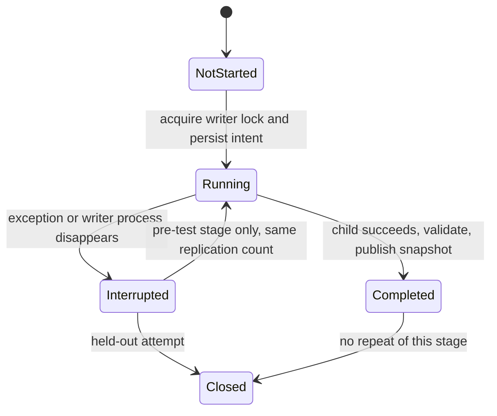

# Experiment persistence audit

This audit covers the direct-real benchmark's train, tune, selection-lock and
held-out lifecycle. It began at `ee189ec` on 6 November 2026, after the
[budget-controller audit](BUDGET_CONTROLLER_TRANSITIONS.md). It concerns storage
and execution transitions, not statistical validity or Lean proofs.

The original [`benchmark/run_real.py`](../benchmark/run_real.py) is hash-locked
by [`results/real_selection.json`](../results/real_selection.json). It and the
published evidence remain unchanged. The new
[`tools/run_real_guarded.py`](../tools/run_real_guarded.py) is an opt-in launcher
for **distinct, fresh experiments**. It does not retrofit or restart the archived
experiment. Direct invocation of the frozen runner retains its historical
behavior.

## Original implicit state machine

| State | Evidence | Permitted transition in the frozen runner |
|---|---|---|
| Untrained | No selection lock; training absent | Train, then write the training record |
| Training available | Training JSON exists | Skip recorded configurations and add missing ones; tune |
| Tuning partial | Tuning JSON has `complete: false` | Skip recorded cells and continue tuning |
| Tuning complete | Tuning JSON has `complete: true` | Select per-budget minima and write the input-hash lock |
| Selection locked | Selection file exists | Reject training, tuning and another lock; start held-out after checking input hashes |
| Held-out started | Start marker binds the selection hash | Reject every further held-out invocation, even after interruption |
| Held-out complete | Final JSON has `complete: true`; raw archive exists | Read/verify stored evidence; never rerun |

The marker does not record liveness. From an incomplete legacy directory alone,
a reader cannot distinguish a live run from an interrupted run. The original
once-only rule intentionally sacrifices restartability after an uncertain start.

Findings:

1. `save()` truncates the destination before writing JSON. A failed write can
   destroy the last usable checkpoint. Training saves only at its end; tuning
   overwrites after each cell and again at completion.
2. Held-out startup uses `exists()` followed by `write_text()`. Two processes
   can both pass the check and proceed. There is no writer lock for the earlier
   stages either.
3. Each held-out cell overwrites the NPZ first and the JSON second. Interruption
   between writes leaves a mixed or truncated pair; the `complete` flag alone
   cannot establish consistency.
4. Training/tuning resume by configuration or cell identity, without checking
   that the requested replication count matches the earlier attempt. Changing
   `--n` can mix counts while the final record advertises only the latest count.

The regression suite executes only the extracted legacy `save` function and
the held-out **marker preamble**, with temporary synthetic inputs. It reproduces
the destructive write and two successful concurrent starts. No legacy sampling
body is executed by these tests.

## Guarded transitions

The wrapper fixes these paths for future runs without editing the locked
implementation. It copies the seven fixed source/input files into a new run
directory and records their SHA-256 identities. Selection and held-out records
are never imported. Initialization refuses every existing destination, including
one left incomplete by a failed initialization.



Stages are ordered `train -> tune -> lock -> test`. Completing one allows the
next; it does not allow repeating or overwriting the completed stage. The fixed
source snapshot also prevents changing the configuration menu between attempts.

| Event | Action and resulting state |
|---|---|
| Invalid stage order/count | Reject before child launch or state mutation |
| Another wrapper holds the OS lock | Reject the competing command before work |
| Launch stage | Copy inputs and the last published results to a unique attempt directory; persist `running` **before** launching the child |
| Successful child exit | Check input/predecessor hashes and output completeness; flush a new snapshot; atomically replace `state.json` to publish it as `completed` |
| Child failure, `KeyboardInterrupt`, `SystemExit`, or publication failure | Preserve the previous snapshot and attempt files; record `interrupted` when possible |
| Launcher dies without recording failure | OS releases its lock; `status` interprets the durable `running` entry as `interrupted` |
| Interrupted train/tune/lock | A later command can start a new attempt from the last published stage; train/tune must retain `--n` |
| Any recorded held-out attempt | Permanently reject all future stage commands, including retuning, even if the child never launched |
| Failure after the completed state was replaced | Keep the committed generation; never roll it back to an earlier state |

On Windows the writer lock uses `msvcrt.locking`; on Unix it uses `flock`.
The lock file is retained permanently. Liveness does not depend on PID reuse,
timestamps or a stale-file timeout. `status` takes a point-in-time observation;
`writer_active` refers to the wrapper, not an orphaned child process.

## Publication and recovery boundaries

Each run contains:

- `inputs/`: fixed source/data bytes, checked against the run identity.
- `attempts/<id>/`: a separate working tree for each invocation, including its
  `runner.log` and any partial output. The frozen runner writes only here.
- `snapshots/<id>/`: complete result sets, copied and flushed after a successful
  child exit. A snapshot includes results from all completed stages.
- `state.json`: the stage ledger and the single published snapshot reference,
  including every output hash. Readers must follow this reference, rather than
  choosing the newest directory by name or timestamp.
- `writer.lock`: the stable operating-system lock target.

Temporary state files are created on the same filesystem and flushed before
`os.replace`. A failed copy or replacement leaves the previous published
snapshot readable. Orphan snapshot directories are ignored. The held-out raw
archive and JSON become visible together through one state replacement.

Publication is **per stage**, not per tuning cell. Interrupted training/tuning
restarts the whole unfinished stage; partial rows are retained for inspection
but never merged or silently resumed. Extra work from failed attempts is not
included in the frozen runner's successful-attempt totals and must be accounted
for separately when reporting experiment costs.

A held-out failure is terminal. There is deliberately no reset, marker removal,
adoption, or held-out resume command. A parent killed abruptly may leave its
child writing into that attempt's scratch directory. It cannot publish a
snapshot, and its durable intent still forbids a replacement held-out launch.
Even a complete but unpublished held-out scratch result is not automatically
promoted after a crash.

The wrapper verifies JSON completion flags, the exact selection-input hash set,
the start-to-selection binding, the held-out cell list, replication metadata,
and the raw archive's member set and CRCs. Published files are subsequently
hash-checked. These are storage checks; they do **not** validate NPY numerical
contents, recompute performance statistics, or certify statistical claims.
Use the existing scientific verifiers for their documented scope. For the
archived run, `python tools/verify_experiment_lock.py --strict` reads the sealed
records and recomputes their summaries without rerunning held-out sampling.

The guarantee assumes a local filesystem honoring exclusive locks and atomic
replacement, and cooperating callers using the wrapper. It cannot stop manual
state edits, direct frozen-runner invocations, or separately initialized runs.
Files are flushed with `fsync`; directory entries are also flushed on Unix.
Python provides no portable directory flush on Windows, so arbitrary power-loss
durability there is not claimed. Process interruption is tested on Windows;
the Unix lock path is registered for CI and is not claimed as locally verified.

## Usage and checks

For a separately authorized new experiment, install the dependencies in
[`benchmark/requirements.txt`](../benchmark/requirements.txt) into the Python
3.12 environment used to invoke the wrapper. The child uses that same interpreter;
an old checkout's `.runtime/python` directory is not copied automatically.
Then use a new directory under `.runtime/experiments/`:

```sh
python tools/run_real_guarded.py init --run-dir .runtime/experiments/NEW_NAME
python tools/run_real_guarded.py train --run-dir .runtime/experiments/NEW_NAME --n 2000
python tools/run_real_guarded.py tune --run-dir .runtime/experiments/NEW_NAME --n 100
python tools/run_real_guarded.py lock --run-dir .runtime/experiments/NEW_NAME
python tools/run_real_guarded.py status --run-dir .runtime/experiments/NEW_NAME
```

The final `test` command uses the same `--run-dir`. Invoke it only once under the
new experiment's protocol, after the required scientific checks. The launcher
does not itself run `verify_production.py`. The pinned source-only verification
record is copied as provenance; initialization does not claim a fresh verifier
run. Do not point the wrapper at the archived repository `results/` directory.

The [regression tests](../tools/test_experiment_persistence.py) use synthetic
output and require only the Python standard library:

```sh
python -B -m unittest discover -s tools -p 'test_experiment_persistence.py' -v
python -B tools/freeze.py --verify
git -c core.whitespace=cr-at-eol diff --check
```

They cover ordering, count validation, immutable input/result identities,
incomplete tuning, marker binding, raw/summary mismatch, competing threads and
processes, abrupt process exit, failed writes/copies/publication, terminal
held-out behavior, and failure to record the interruption itself. A dedicated
[CI workflow](../.github/workflows/experiment-persistence.yml) runs the suite on
Windows and Ubuntu; adding it is not evidence that CI has already passed.

### Local validation on 6 November 2026

- All 20 new persistence tests passed under Python 3.12.2 on Windows. The desktop
  sandbox denied renames in its system temporary directory, so this local run
  set Python's `tempfile.tempdir` to `.runtime/persistence-tests` before discovery.
  The tests still exercised real `os.replace` and operating-system locks.
- All 20 existing `test_validation.py` tests passed. The archived experiment's
  strict verifier confirmed nine input locks and recomputed four held-out cells
  from stored arrays (`accept=False`). These checks used the existing NumPy/Numba
  environment in the sibling checkout's `.runtime/python`; no packages were
  installed and no held-out samples were generated.
- The full toolkit suite passed all 277 tests after the controller commit was
  integrated into the development branch.
- `freeze.py --verify` passed. A separate before/after SHA-256 comparison found
  all 2,270 protected evidence/source/manifest paths unchanged. This includes
  the frozen runner, every tracked `results/`, `inputs/` and `research/` file,
  the preserved rare-event packages and tracked lock/manifest files.
- Relative file links and the whitespace check passed. No Lean rebuild or new
  scientific experiment was run. The new CI workflow has not run locally.
