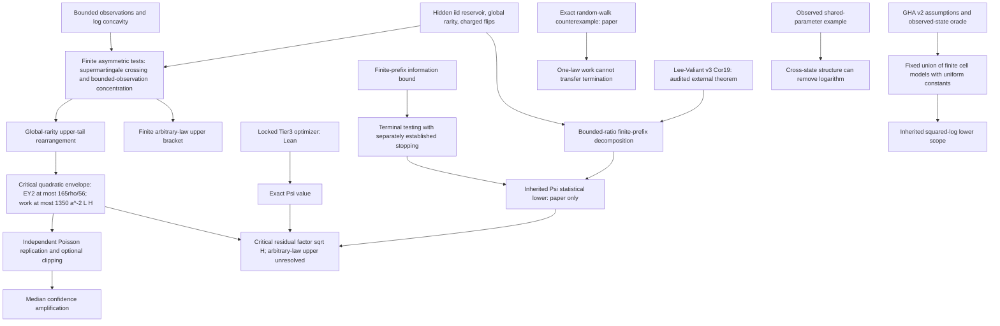

# Claim dependency graph

New paper roots: critical, arbitrary bracket, bounded-channel extension, stopping counterexample/testing bridge, qualified known-gap adaptation. No new complete Lean statistical root is claimed. Exact arithmetic diagnostics are leaves checking finite instances, not proof dependencies for universal statements.

Formal dependency closures and standard axiom checks are in `formal/`; the old locks were checked, not regenerated. The paper-extension specification has a separate lock. Empirical results depend on the preregistered source hash, independent final seed families, original-real oracle check, and cost/calibration contract. Historical baseline replay and new held-out data are distinct nodes.
